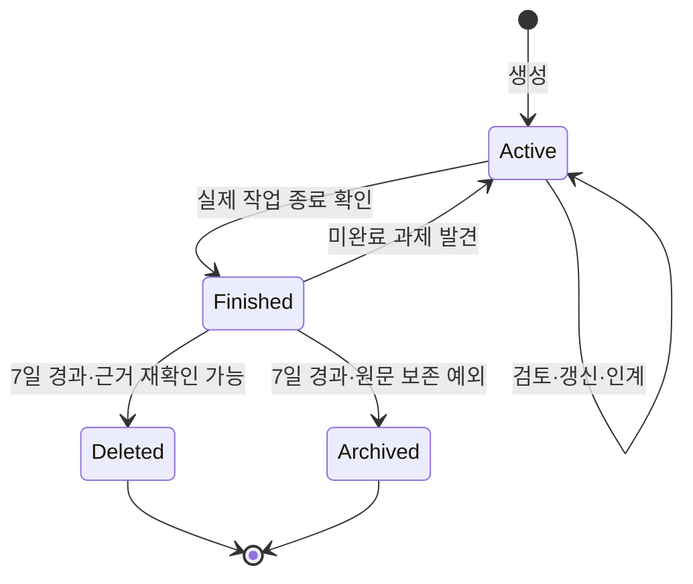

# Inbox

`.inbox/`는 조사·계획·검토·인계 등 **정본으로 확정되지 않은 작업 자료**를 보관하는 공간입니다. 확정된 지식은 적절한 정본에 반영하고, 작업 자료 자체를 정책이나 지침으로 취급하지 않습니다.

## 위치와 파일명

작업 단위별로 자료를 묶습니다. 별도 식별자가 없으면 날짜를 사용합니다.

| 기준 | 작업 디렉터리 |
| --- | --- |
| GitHub Issue·PR | `.inbox/github-<number>/` |
| 브랜치 | `.inbox/branch-<slug>/` |
| 날짜 | `.inbox/YYYY-MM-DD/` |

날짜는 작업 디렉터리를 처음 만든 날입니다. 단일 문서나 디렉터리 번들을 둘 수 있으며, 번들 안에 다른 디렉터리를 중첩하지 않습니다.

파일은 `00-research-topic.md`, `01-summary.md`처럼 번호와 주제를 사용합니다. 원본의 내용을 별도 문서로 확장할 때는 `00-research-topic-sources.md`처럼 같은 번호와 이름 뒤에 확장 내용을 붙입니다. **유형 접두사와 확장 접미사는 선택 사항**이며, 접미사에 날짜·상태를 넣지 않습니다. 구체적인 작성 규칙은 [AGENTS.md](AGENTS.md)를 참고합니다.

## 라이프사이클

작업 중에는 문서를 갱신하고 검토·인계할 수 있습니다. 지속해서 필요한 결론은 [Working Knowledge](../docs/documentation/README.md#working-knowledge)에 따라 정본에 반영합니다. **정본 반영이나 PR의 merge·close가 작업 종료를 뜻하지는 않습니다.**

종료한 자료라도 생성 또는 마지막 실질적 갱신 후 **7일 동안 보호**합니다. Git merge·경로 이동은 이 기간을 새로 시작하지 않습니다. 보호 기간 중이거나 보존 여부가 불확실하면 유지합니다.

## 정리와 보존

- **삭제 우선:** 실제 작업이 종료되었고 필요한 맥락을 정본·코드·PR·검증 기록·Git 이력에서 확인할 수 있으면 7일 보호 후 삭제합니다.
- **아카이브는 예외:** 현재 정본이 원문을 직접 참조하거나 재현·감사에 원문이 꼭 필요하고, Git 이력만으로 다시 찾는 비용이 실질적으로 클 때 검토합니다. 경로는 `.inbox/archive/YYYY-MM-DD/`이며 날짜는 아카이브한 날입니다.

미완료 작업은 종료된 기록으로 아카이브하지 않습니다.
