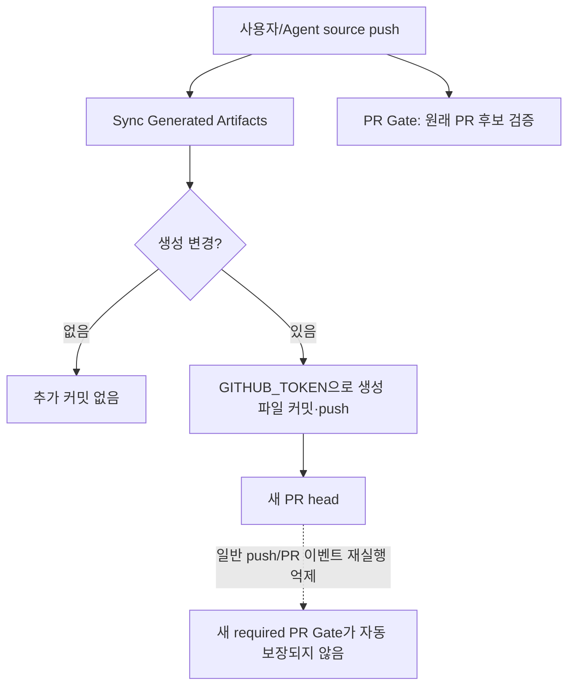

# PR #294 — Generated Sync 기술 적합성 조사

> 2026-11-16 정적 조사. PR base `fa5be3bd63e9c29c30017b9e8c833018c092b9a7`, 조사 시작 head `3ab2b381d4a0fc3fc233d8e7fd61b2fd649a89d1`. 이 보고서는 비정본 의사결정·인계 자료이며 워크플로 실행 승인이나 운영 검증이 아니다.

## 결론

**GitHub Actions + 기존 generator + 기본 `GITHUB_TOKEN`은 기술 선택으로 적절하다. 현재 워크플로를 목표의 완성 구현으로 보는 것은 부적절하다.** 자동 커밋까지는 구현했지만, 이미 열린 PR에서 봇 커밋 이후 **최신 head 또는 merge candidate에 대한 required `PR Gate`의 자동 재검증**을 보장하지 못한다. 신규 토큰이 없어서 문제가 생기는 것이 아니라, GitHub Actions의 **이벤트 재귀 억제와 required check의 대상·트리거 계약**이 충돌한다.

- **완전 자동화가 필수라면:** 기존 요구사항(추가 GitHub App/PAT/Secret 없음, 기존 required `PR Gate` 인정, 열린 PR에서 사람의 후속 이벤트 없음)을 유지한 채로 현재 방식에 dispatch만 덧붙이지 않는다. 먼저 실현 가능한 권한·이벤트·체크 계약을 입증하고, 입증할 수 없다면 요구사항 중 조정할 항목을 결정한다.
- **추가 인증 수단을 허용하지 않는다면:** 권장 기본안은 **읽기 전용 PR Gate에서 생성 파일 drift를 차단하고, 생성·커밋은 authoring 단계로 되돌리는 것**이다. 이 경우 자동 커밋 목표는 충족하지 않는다고 명시한다.
- 별도 GitHub App installation token은 이벤트 연계를 해결할 수 있는 후보지만 설정·비밀키·권한 관리가 추가되므로 현재 제약에서는 채택하지 않는다. 단순 PAT, Ruleset 우회, 가짜 status 성공 보고도 채택하지 않는다.

**판정: 설계 보완 필요 / Draft 유지 / 신규 write E2E 미검증.**

## 목표와 범위

[PR #294](https://github.com/mols3131d/mols-agent-assets/pull/294)와 [최신 작업 목표](07-status-and-goals-2026-11-16.md)에 따르면 원하는 것은 다음 두 결과의 동시 달성이다.

1. Local hook을 거치지 않는 GitHub API·MCP·ChatGPT 편집에서도 기존 생성기를 통해 `docs`/`catalog` 인덱스와 route 파일을 **자동 동기화하고 생성 파일만 커밋**한다.
2. **이미 열린 PR**에서 추가 사람 push 없이 **최신 변경 후보**의 실제 required `PR Gate`를 통과시킨다.

제약: 기본 `GITHUB_TOKEN`만 허용, `main` 직접 변경·강제 push·Ruleset 우회·자동 merge 없음. [CI 정본](../../docs/development/ci.md)은 읽기 전용 입장 심사와 쓰기형 maintenance를 구분하고, [GitHub 정책](../../docs/development/github.md)은 권한을 바꾸는 Actions 변경에 사람의 독립적인 검토·승인을 요구한다.

범위: `.github/workflows/generated-sync.yml`, `pr-gate.yml`, `branch-check.yml`, `scripts/generated_artifacts*.py`의 원격 소스와 GitHub 공식 계약. 실제 Ruleset/Actions repository 설정, 격리된 쓰기 테스트 및 생성 커밋 후 최신 체크의 실행 증거는 확인하지 않았다.

## 현행 구현 평가

| 구성 | 평가 | 근거 및 한계 |
| --- | --- | --- |
| GitHub Actions `push` 기반 maintenance | **적합(조건부)** | hookless remote write를 포착하고 서버에서 생성기를 재사용한다. 다만 write-back 이후 PR 검증 연계는 별도 문제다. |
| 기본 `GITHUB_TOKEN` + `contents: write` | **쓰기 작업에는 적합** | Actions가 job별 임시 GitHub App installation token을 자동 발급한다. Runner 내 생성·테스트에는 토큰이 필요 없고, 원격 push에는 인증이 필요하다. 권한은 write job에만 필요하다. [공식 계약](https://docs.github.com/en/actions/concepts/security/github_token) |
| `uv run --locked --no-default-groups --group test` | **적합** | 저장소의 기존 generator·검증기와 lock을 재사용하며 중복 알고리즘을 만들지 않는다. 실제 runner 동작은 미검증이다. |
| `sync` → `validate --all` | **적합하지만 증거 범위 제한** | 검증기는 작업 트리의 현재 생성 출력과 기대 출력을 비교한다. 직전 커밋/PR merge candidate가 다시 검증되었다는 의미가 아니다. |
| generated-only `git add` 및 no-op 조건 | **정적 적합** | `docs/**/INDEX.tsv`, `catalog/INDEX.tsv`, `route/*.jsonl`, `.agents/route/*.jsonl`만 staging; `git diff --cached --quiet`이면 커밋 생략. 실제 신규/삭제 파일·경합 E2E는 미검증. |
| `gh auth setup-git` 후 명시적 branch push | **적합(조건부)** | checkout의 `persist-credentials: false` 설정과 인증의 지연 사용은 합리적이다. force push를 하지 않는 점도 적합하지만, non-fast-forward 재시도·격리 복구는 별도 검증이 필요하다. |
| `Branch Check`, `PR Gate` 분리 | **유지 권장** | `Branch Check`는 브랜치 조기 진단, `PR Gate`는 `pull_request` merge candidate의 읽기 전용 입장 심사다. `PR Gate`를 쓰기형 maintenance로 바꾸지 않는다. |
| `workflow_dispatch` | **복구 조작 후보일 뿐** | workflow가 default branch에 있어야 이벤트를 받을 수 있다. 또한 dispatch 실행으로 생긴 일반 Actions job check는 PR required check를 충족하지 않는다. [수동 실행](https://docs.github.com/en/actions/how-tos/manage-workflow-runs/manually-run-a-workflow), [required checks](https://docs.github.com/en/pull-requests/how-tos/merge-and-close-pull-requests/troubleshooting-required-status-checks) |

현재 `generated-sync.yml`은 `main`/태그를 제외하고, 생성 파일이 변경되면 기본 토큰으로 그 브랜치에 커밋한다. 기존 `pr-gate.yml`은 `pull_request`에서만 실행되고 `contents: read`다. **두 워크플로가 각각 자신의 역할은 수행하도록 설계됐지만, 하나의 성공이 다른 하나의 최신 증거로 자동 연결되지는 않는다.**

## 확인된 제약과 위험

### R1 · High — 생성 커밋 후 latest required check 공백

GitHub는 `GITHUB_TOKEN`으로 수행한 일반 push가 후속 `push` 또는 `pull_request` Actions 실행을 만들지 않는다고 명시한다. 다만 `workflow_dispatch`, `repository_dispatch`는 예외이고, 토큰으로 **PR 자체를 생성·갱신**해 발생한 특정 PR 이벤트는 승인 대기 실행을 생성할 수 있다. 이는 **단순 git push**와 다른 동작이며 사람 개입 없는 목표를 해결하지 않는다. [GitHub 공식 설명](https://docs.github.com/en/actions/concepts/security/github_token)

Required check는 이전 SHA의 성공으로 대신할 수 없고, GitHub는 PR의 merge commit 체크가 있는지에 따라 검사 대상을 결정한다. [Required status troubleshooting](https://docs.github.com/en/pull-requests/how-tos/merge-and-close-pull-requests/troubleshooting-required-status-checks)

**영향:** 이전 `PR Gate` 통과가 신규 생성 커밋의 성공 증거가 아니다. 실제 checkout/check 경로가 현재 PR에서 어떻게 평가되는지는 별도 E2E 확인이 필요하다.

### R2 · High — dispatch/chaining을 추가해도 기존 required check는 충족되지 않음

GitHub는 PR에 대해 평가되는 일반 Actions job check의 이벤트를 `push`, `pull_request`, `pull_request_review`, `pull_request_target`, `deployment`, `deployment_status`로 제한한다. `workflow_dispatch`의 성공 job은 PR 필수 체크로 인정되지 않는다. `workflow_run`도 일반 job check가 PR 필수 체크를 대신하는 방법이 아니며 해당 이벤트의 실행 ref는 기본 브랜치다. [Required checks](https://docs.github.com/en/pull-requests/how-tos/merge-and-close-pull-requests/troubleshooting-required-status-checks), [Events](https://docs.github.com/en/actions/reference/workflows-and-actions/events-that-trigger-workflows)

**영향:** `GITHUB_TOKEN`으로 `workflow_dispatch`를 호출해 "테스트가 성공했다"는 기록만 추가하는 설계는 부족하다. 체크 이름·대상 SHA·실제 merge candidate·Ruleset의 허용된 source를 검증해야 한다.

### R3 · High — 변경 가능한 소스를 실행하는 write-capable workflow

`on.push`의 branch workflow가 저장소 generator와 설치 의존성을 실행하며 job 전체에 `contents: write`가 적용된다. 이 경우 해당 branch에 쓰기 가능한 주체가 workflow·generator·스크립트를 변경할 수 있는 통제 표면이다. `Draft`는 실행 차단 정책이 아니다.

**대응:** 독립 리뷰와 사람 승인 전 write E2E를 수행하지 않는다. 실행 권한·workflow 활성화·branch actor·fork 동작을 실제 설정으로 확인한다. 필요하다면 read 검증과 최소 write job을 분리하되, 분리 과정에서 신뢰할 수 없는 artifact/script를 privileged job에서 실행하지 않는다. `pull_request_target`으로 단순 전환하는 것은 고권한 실행의 보안 위험이 크므로 배제한다. [GitHub 보안 지침](https://docs.github.com/en/actions/reference/security/securely-using-pull_request_target)

### R4 · Medium — 격리 E2E 및 경합 복구 근거 없음

`cancel-in-progress`와 force push 미사용은 무리한 덮어쓰기를 피하지만, 동시 remote 변경 시 generated commit push 실패의 자동 복구를 보장하지 않는다. 경로 필터는 현재 generator 입력과 함께 유지해야 하며 새로운 source가 추가되면 동기화 대상 누락이 생길 수 있다.

**대응:** 격리 브랜치에서 no-op, 생성 파일 신규·변경·삭제, source push와 봇 push의 SHA, non-fast-forward, 변경 파일의 generated-only 여부를 측정한다. 실패 시 최신 remote를 다시 확인하고 재생성; blind retry/force push는 금지한다.

### R5 · Low — PR 정보·비정본 문서의 유지비용

기존 PR 본문의 `revision.head`와 일부 문서 링크·파일 목록은 현재 스냅샷보다 오래되었다. `.inbox/github-294/`는 조사·인계용 **비정본**이며 같은 경고를 여러 문서에 반복하면 이후 판단 비용이 커진다. 다음 구현·검증 시 PR 본문을 업데이트하고, 완료 후 중복 작업 기록을 정리할 수 있다.

## 대안 비교

| 설계 | 자동 생성/커밋 | 열린 PR의 최신 required check | 추가 인증/운영 | 판단 |
| --- | --- | --- | --- | --- |
| **A. 읽기 전용 CI + authoring 시 sync** | 생성 가능, GitHub 자동 커밋은 **불가** | 기존 `pull_request` 검증 유지 | 최소 | **권장 기본안** — 단순·안전하지만 자동 커밋 요구는 포기 |
| **B. 현재 `GITHUB_TOKEN` push write-back** | **가능(구현됨, E2E 미확인)** | **자동 보장 안 됨** | 최소 | 부분 기능. 완성 목표로 머지 비권장 |
| **C. B + `workflow_dispatch`/`workflow_run`** | 가능 | 일반 Actions job만으로는 **불충족** | workflow 증가 | **기각** — 필요한 check를 만들지 못함 |
| **D. 별도 GitHub App 설치 토큰** | 가능 | 정상 `push`/PR 이벤트 연계 후보 | App·키·권한 관리 추가 | **조건부 후보** — 현재 추가 인증 금지 제약과 충돌 |
| **E. Checks/commit status API로 SHA에 상태 발행** | 가능 | source·검증 대상·Ruleset 계약 별도 입증 필요 | write scope와 커스텀 CI 관리 증가 | **비권장** — 기존 `PR Gate`를 표시만으로 대체하거나 성공을 합성하지 않음 |

대안 A는 **요구사항 변경안**이다. B는 현재 목표에서 자동 검증을 빠뜨린 상태다. D·E가 실제 repository Ruleset에서 성립한다고 단정하지 않는다. 별도 GitHub App을 허용한다면 GitHub의 공식 이벤트 계약과 실제 required check 매핑을 검증한 뒤 결정해야 한다.

## 권장 진행 순서

1. **불변 조건 우선순위 결정:** "새로운 인증 수단 없음"과 "이미 열린 PR에서 봇 커밋 후 required `PR Gate`까지 무인 자동화"를 모두 반드시 지켜야 하는지 확인한다. 현재 구조에 dispatch를 더하는 방식으로 해결됐다고 가정하지 않는다.
2. **최소 기술 실험 설계:** 현재 Ruleset의 required check 이름·허용 source·strictness·merge queue 사용 여부, 실제 bot push 권한·workflow 활성 상태를 읽기 전용으로 확인한다. 필요한 체크 대상은 **최종 head 또는 GitHub가 평가하는 merge candidate**로 기록한다.
3. **설계 선택:** 자동 커밋이 필수가 아니면 A로 단순화한다. 반드시 필요하면 D 또는 별도의 검증 가능한 설계를 독립 검토하되, 인증 금지와 충돌하는 변경은 명시적 결정 전 구현하지 않는다.
4. **승인 후 격리 E2E:** 사람의 write 테스트 승인을 받은 뒤 별도 브랜치/PR에서 no-op, generated-only commit, 최신 실제 required `PR Gate`, 경합·실패 복구를 확인한다. `main`·현재 PR 브랜치를 실험 대상으로 쓰지 않는다.
5. **PR 수렴:** 새 설계에 맞게 구현·문서·검증 결과를 갱신하고, Draft 해제·머지는 독립적인 사람 승인과 최신 required check 통과 이후에만 판단한다.

### 인수 기준

- [ ] 채택 설계가 자동 커밋 여부와 PR Gate 검증 범위를 명시하고, 충족하지 못한 요구를 숨기지 않는다.
- [ ] 검증 단계는 읽기 전용이고, 생성 파일에 대한 write는 최소 범위의 권한·브랜치로 제한된다.
- [ ] 최신 PR head/merge candidate의 **실제 required `PR Gate`**가 봇 커밋 뒤 정상적으로 완료된다(자동화 목표를 유지한 경우).
- [ ] 신규 생성/수정/삭제와 no-op의 실제 결과 및 source/bot SHA, Actions run URL, 변경 파일을 기록했다.
- [ ] E2E 승인, 보안 검토, 실패 복구, Ruleset/체크 source의 미검증 부분을 명확히 구분했다.
- [ ] PR 본문과 최신 HEAD가 일치하며 사람의 최종 검토·승인 전 머지하지 않는다.

## 근거와 검증 수준

- **직접 확인:** PR #294 메타데이터(`Open`/`Draft`, 21 commits, 9 files, 위 기준 SHA), `generated-sync.yml`의 trigger·permission·git stage/push, 두 검증 워크플로의 이벤트와 권한, `scripts/generated_artifacts_sync.py`/`_validate.py`의 생성·비교 semantics.
- **공식 계약 확인:** [`GITHUB_TOKEN`와 후속 이벤트](https://docs.github.com/en/actions/concepts/security/github_token), [PR required status checks와 대상 SHA](https://docs.github.com/en/pull-requests/how-tos/merge-and-close-pull-requests/troubleshooting-required-status-checks), [Actions event/ref](https://docs.github.com/en/actions/reference/workflows-and-actions/events-that-trigger-workflows), [workflow dispatch의 default branch 제한](https://docs.github.com/en/actions/how-tos/manage-workflow-runs/manually-run-a-workflow), [Ruleset status source](https://docs.github.com/en/repositories/configuring-branches-and-merges-in-your-repository/managing-rulesets/available-rules-for-rulesets).
- **Not Verified:** 실제 repository Ruleset·Actions 운영 설정, 신규 write workflow의 실행·bot push·no-op·경합·최신 required check E2E. CI 통과 이력은 **새 write 경로의 성공 증거가 아니다**.

이 문서는 설계 선택을 위한 근거이며 작업 지시나 승인이 아니다. 기존 [상태·목표 기록](07-status-and-goals-2026-11-16.md)과 [심층 리뷰](05-review-report-deep-2026-11-12.md)의 당시 근거를 대체하거나 사후 수정하지 않는다.
