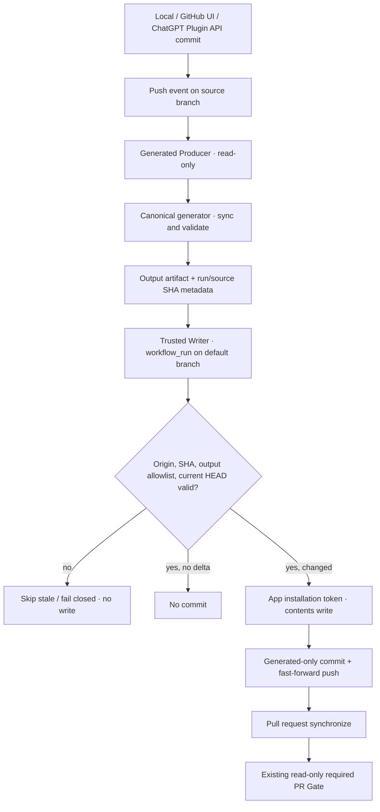

# PR #294 — GitHub App 기반 자동 생성·검증 설계

> 2026-11-16 설계 인계. 현재 대상 PR은 [#294](https://github.com/mols3131d/mols-agent-assets/pull/294), 당시 head `2ce6e5d80cecd7082c9ed4b3cc7b5f3b14a4e734`. 적용 전 현재 SHA·설정·권한을 다시 확인한다. 이 문서는 비정본 제안이며 실행·승인이 아니다.

## 결정과 변경된 제약

**목표:** 로컬 Git hook, GitHub Contents API, MCP/ChatGPT GitHub 플러그인, 웹 UI 등 입력 경로와 관계없이 작성 원본이 변경되면 기존 generator로 committed projection을 갱신하고, 이미 열린 PR의 최신 merge candidate가 **실제 required `PR Gate`**로 다시 검증되도록 한다.

이전 [목표·상태 기록](07-status-and-goals-2026-11-16.md)과 [기존 인계](01-handoff.md)의 **“GitHub App·추가 Secret 금지”는 사용자와의 후속 설계 합의로 변경**되었다. 개인 PAT는 여전히 도입하지 않는다. 본 문서의 설계 선택은 별도 GitHub App 설치·사용과 write workflow의 *인간 승인* 자체를 대신하지 않는다.

불변 조건:
- `main` 직접 push, Ruleset bypass, 자동 merge, 가짜 성공 status/check 생성, force push 금지.
- `PR Gate`는 읽기 전용 merge admission이며 마지막 커밋의 실제 검사 결과만 사용한다.
- 생성 파일은 작성 원본이 아니라 projection이다. 기존 generator·validator를 교체하거나 생성 알고리즘을 workflow에 중복 구현하지 않는다.
- 미승인 privileged workflow에서 untrusted branch의 스크립트·액션·의존성을 실행하지 않는다.
- 영향 분석이 불명확하면 누락보다 확대 검증 또는 명시적 실패를 선택한다.

## 아키텍처

### 1. Producer: read-only / untrusted

- 기존 `.github/workflows/generated-sync.yml`의 generator 실행 경로를 재사용하되 `permissions: contents: read`, 어떤 App Secret도 받지 않고 **원격 write를 제거**한다.
- `on: push`로 **같은 저장소의 main 외 branch**에서 로컬/API/MCP 커밋을 감지한다. 실제 workflow trigger는 현재 checkout ref에 해당 파일이 있어야 한다. fork에서 온 `pull_request` 이벤트로 privileged writer를 호출하지 않는다.
- 기존 `uv run --locked --no-default-groups --group test python -m scripts.generated_artifacts sync` → `validate --all` 후 생성 파일만을 정해진 구조의 artifact로 업로드한다. artifact는 *데이터*이지 신뢰된 코드나 승인 근거가 아니다.
- source 입력 경로(`docs/`, `catalog/`, `src/rulesync/.rulesync/skills/`, `src/rulesync/.rulesync/subagents/`, `scripts/`, `rulesync.lock`, `rulesync.jsonc`, `skills-lock.json`, `.agents/route/families.json`)와 output 경로의 영향 범위를 기존 generator의 `PROJECTIONS` 계약과 맞춘다.
- 생성 출력만 수동 삭제/수정한 API 커밋도 복구 범위에 넣을지 결정한다. 지원한다면 output-only 변경을 trigger에 포함하고 **writer App이 만든 output-only 커밋의 재진입을 신뢰된 actor + 변경 경로로 억제**하거나 무변경 no-op이 확실히 종료됨을 검사한다. source가 포함된 commit을 actor만으로 무조건 무시하지 않는다.
- Source branch에서 producer workflow·generator 자체를 수정할 수 있으므로 **producer 성공은 artifact의 신뢰성을 보장하지 않는다**. 입력 검증과 최종 PR Gate는 별개다.

### 2. Trusted Writer: default branch의 privileged 경계

- `workflow_run` (해당 Producer workflow의 `completed`)로 **기본 브랜치에 등록된 고정 workflow**를 실행한다. 권한 있는 writer script/action은 default branch에서만 로드한다. `workflow_run`의 `GITHUB_REF`/`GITHUB_SHA`는 source branch가 아닌 **default branch**라는 점에 주의한다.
- `GITHUB_TOKEN`은 provenance 확인, run artifact 읽기, trusted script checkout 등 **read-only** (`actions: read`, 필요한 경우 `contents: read`) 용도로 한정한다. App 개인키는 producer와 일반 PR Gate job에 전달하지 않는다.
- 확인해야 할 최소 조건: trigger workflow name/ID 및 성공 상태, 원본 이벤트 `push`, repository owner·ID 일치, fork가 아닌 현재 저장소, 실제 branch ref이며 `main` 아님, `workflow_run.head_sha`와 origin metadata 일치, artifact가 해당 run의 유일한 기대 산출물, source ref 최신 HEAD가 검증된 SHA와 일치.
- Artifact의 path traversal, symlink, 예상 밖 파일·확장자, 허용되지 않은 수정/삭제 및 과도한 크기를 거부한다. 허용되는 *최종 staged diff*는 `docs/**/INDEX.tsv`, `catalog/INDEX.tsv`, `route/*.jsonl`, `.agents/route/*.jsonl`로만 제한한다. 경로 패턴만 믿지 말고 예상 output inventory와 git status를 함께 검증한다.
- **절대로** PR branch에서 checkout된 script, artifact의 실행 파일/command, 악의적 cache를 privileged 환경에서 실행하지 않는다. 필요한 검증용 parser/script도 기본 브랜치의 신뢰된 코드만 사용한다. `pull_request_target`로 단순 전환하지 않는다.
- 브랜치 HEAD가 이동했으면 해당 artifact를 **폐기**한다. 최신 source push가 새 Producer를 만들지 않았거나 cancellation 때문에 누락되었다면 별도 승인된 복구 이벤트로 재처리한다. non-fast-forward는 force push하거나 덮어쓰지 않는다.
- no-op이면 commit/push 없음. 실제 변경 시에만 생성 출력 파일을 커밋한다. GitHub App installation token은 **push 직전에** `actions/create-github-app-token`으로 발급, 대상 설치는 이 저장소 단독, `permission-contents: write`로 제한한다. write job의 `GITHUB_TOKEN`에 `contents: write`를 부여하지 않는다.
- `concurrency`는 브랜치별 처리 경합을 줄이는 보조 수단일 뿐이다. Git ref 최신성 확인 및 fast-forward 검증을 대신하지 않는다.

### 3. PR Gate: 기존 admission 경계 유지

- `.github/workflows/pr-gate.yml`의 `pull_request` 기반 read-only 체크를 필수 조건으로 유지한다. `branch-check.yml`도 조기 진단으로 유지한다.
- **GitHub App** 토큰을 사용한 source branch push는 정상 후속 `push`와 열린 PR의 `pull_request: synchronize`를 발생시킬 수 있다. **자동 실행·체크 인정 여부는 설치·Ruleset·실제 테스트로 증명**한다.
- `workflow_run`이나 `workflow_dispatch`가 만든 성공한 **일반 Actions job check는 기존 PR의 required `PR Gate`를 대체하지 않는다**. 마지막 봇 커밋 이후 GitHub가 평가하는 head 또는 test merge commit에 해당 `PR Gate`의 성공이 있어야 한다.

## 신뢰·권한 매트릭스

| 경계 | 소스/실행 기준 | 필요한 인증 | 쓰기 |
| --- | --- | --- | --- |
| Local/API/ChatGPT authoring | 실제 source branch | 사용자가 자신의 연결을 승인·검증 | 본인 branch에 한정 |
| Generated Producer | source branch checkout | 기본 `GITHUB_TOKEN`, `contents:read` | artifact 업로드만; 저장소 무쓰기 |
| Trusted Writer | default branch의 **trusted workflow/script** | 읽기용 `GITHUB_TOKEN`, 마지막 단계에서 별도 App token | 허용된 generated-only branch push |
| PR Gate | PR test merge candidate | 기본 `GITHUB_TOKEN`, `contents:read` | 없음 |

App 등록·설치는 `mols3131d` 소유 저장소 하나로 한정하고 기본 권한은 `Contents: Read and write`, 필수 `Metadata: Read` 이외에는 요청하지 않는다. GitHub App Client ID는 `GENERATED_SYNC_APP_CLIENT_ID` repository variable, PEM은 `GENERATED_SYNC_APP_PRIVATE_KEY` Actions secret으로 **사람이 직접** 등록한다. Secret의 실제 값은 repository, PR, artifact, log, 채팅에 남기지 않는다. App 이름/slug는 등록 결과를 확인하기 전 하드코딩하지 않는다. App에 Ruleset bypass를 부여하지 않는다.

## 단계적 활성화

`workflow_run` writer는 **파일이 default branch에 존재하지 않으면 실행되지 않는다**. PR #294에 Producer와 Writer를 동시에 추가하고 병합 이전에 프로덕션과 동일한 E2E를 실시할 수 있다고 가정하지 않는다.

1. 로컬·모의 입력으로 trusted writer validator를 테스트한다. App·Secret 없는 정적 코드 검토와 unit/integration 테스트부터 수행한다.
2. 별도 **선행 bootstrap PR**에 기본 브랜치에서 동작하되 **disabled/fail-closed** 상태인 writer만 추가하고, 독립적 인간 보안 리뷰 및 명시적 승인 후 squash merge한다. 이 단계는 기본 브랜치의 control surface 변경이므로 별도 승인 대상이다.
3. 사람이 App을 생성·한 저장소에 설치하고 Repo variable/secret을 입력한다. 실제 Ruleset, workflow permissions, actor 허용과 App push 정책을 확인한다.
4. 승인된 **격리 테스트 branch 및 열린 테스트 PR**에서 Producer → artifact → Writer → App push → 실제 `PR Gate`의 SHA별 결과를 검증한 후 활성화를 결정한다. 필요하면 보호된 test repository에서 우선 시험한다.
5. 성공 근거가 충분할 때 PR #294를 최종 구현으로 갱신하고, 사람의 최종 승인 전 Draft를 유지한다. `main` 직접 push나 자동 merge는 허용하지 않는다.

**Note:** 사용자와의 대화에서 App 기반 설계 방향은 선택되었으나, App 설치·개인키 등록·write workflow 활성화·테스트·머지까지 승인되었다는 의미는 아니다.

## 현재 구현과 충돌하는 지점

- [기존 워크플로](../../.github/workflows/generated-sync.yml)는 `contents:write`, `github.token` 기반 직접 push를 포함한다. 새 설계에서는 Producer로 역할을 축소해야 한다.
- [기존 조사](08-generated-sync-architecture-research.md)의 기본 `GITHUB_TOKEN` 한정 권고는 변경 전 제약에 대한 평가다. 새로운 선택의 보안 타당성은 이 설계와 실제 E2E로 다시 검증한다.
- [CI 정본](../../docs/development/ci.md), [GitHub 권한·승인 정본](../../docs/development/github.md), [VCS 정본](../../docs/development/vcs-git.md)의 강제 규칙을 이 문서가 재정의하지 않는다.

## GitHub 공식 근거

- [`GITHUB_TOKEN` 이벤트 억제와 GitHub App token 예외](https://docs.github.com/en/actions/how-tos/write-workflows/choose-when-workflows-run/trigger-a-workflow)
- [`workflow_run` 기본 브랜치·ref·triggers](https://docs.github.com/en/actions/reference/workflows-and-actions/events-that-trigger-workflows#workflow_run)
- [App 인증과 repository variable / secret](https://docs.github.com/en/apps/creating-github-apps/authenticating-with-a-github-app/making-authenticated-api-requests-with-a-github-app-in-a-github-actions-workflow)
- [`actions/create-github-app-token` action](https://github.com/actions/create-github-app-token)
- [Required status checks의 이벤트와 SHA](https://docs.github.com/en/pull-requests/how-tos/merge-and-close-pull-requests/troubleshooting-required-status-checks)
- [`pull_request_target`/`workflow_run` 보안 경계](https://docs.github.com/en/actions/reference/security/securely-using-pull_request_target)
