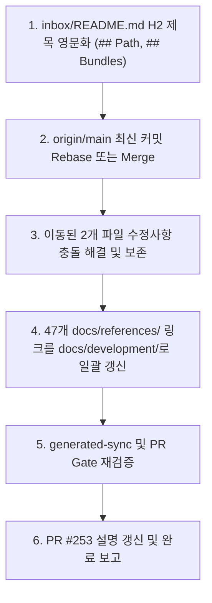

# 저장소 전체 문서 정합성 전수조사 보고서 (Exhaustive Consistency Audit)

## 1. 개요 및 목적

본 보고서는 PR #253([#253 docs: 문서 정합성 조사 및 수정](https://github.com/mols3131d/mols-agent-assets/pull/253))의 핵심 보류 과제인 **저장소 전 범위 문서 정합성 전수조사(Exhaustive Consistency Audit)**를 수행하고 결과를 정리한 공식 아티팩트입니다.

기존 PR #253의 검증은 표본 조사(디렉터리별 샘플 및 93개 문서 링크 점검)에 한정되어 리뷰([review.md](review.md))에서 지적된 F1(완료 범위 입증 부재)을 해소하지 못했습니다. 이에 따라 Git에서 추적 중인 **전체 330개 Markdown 파일**과 **652개 내부 상대 링크 및 앵커**, **폐기 자산 잔존 참조**, **도구 CLI 정합성**, **최신 `origin/main`과의 경로 이동 정합성**을 전수 조사했습니다.

- **조사 기준 리비전**: PR #253 HEAD (`572e3c577c59561979f92078aa0ae6bb3077b593`)
- **비교 대상 원격 기준**: `origin/main` (`9c08b43`)
- **조사 일시**: 2026-11-02
- **대상 파일 수**: 총 330개 Markdown 파일 (저장소 내 git 추적 대상 100%)

---

## 2. 전수조사 요약 결과 (Executive Summary)

```text
[전수조사 통계 요약]
├─ 조사 대상 Markdown 파일: 330개 (전수)
├─ 검사된 내부 상대 링크/앵커: 652개
│  ├─ 결손 링크 (Dead Links): 0건 (100% 정상 도달)
│  └─ 결손 앵커 (Anchor Issues): 0건 (100% 정상 도달)
├─ 언어 정책 (H1–H3 영어 제목) 위반: 1개 파일 (2개 제목)
│  └─ inbox/README.md ('## 경로', '## 번들')
├─ Frontmatter 스키마 준수: docs/ 61개 파일 100% 통과
├─ 생성 인덱스/라우팅 정합성: docs/INDEX.tsv, route/*.jsonl 100% 일치
├─ 폐기/개명 자산 잔존 활성 참조: 0건 (오인 위험 없음)
└─ 최신 origin/main 경로 이동 영향: 47개 링크가 이동 전 구 경로(docs/references/...) 참조 중
```

| 검증 축 | 대상 범위 | 검사 수 | 결과 | 핵심 내용 |
| :--- | :--- | :--- | :---: | :--- |
| **축 1. 언어 정책 (Headings)** | 저장소 전체 H1–H3 | 330개 파일 | ⚠️ 주의 | 활성 문서 중 `inbox/README.md` 2개 제목 한국어 잔존 |
| **축 2. 마크다운 상대 링크** | 전체 내부 링크 및 앵커 | 652개 링크 | ✅ Pass | 0건 결손 (모든 내부 대상 파일 및 앵커 정상 도달) |
| **축 3. Frontmatter 스키마** | `docs/` 및 `catalog/` | 93개 파일 | ✅ Pass | `scripts/docs_frontmatter_validate.py` 100% 통과 |
| **축 4. 인덱스 및 라우팅** | `INDEX.tsv`, `route/` | 전체 생성물 | ✅ Pass | `scripts/generated_artifacts_validate.py` 100% 통과 |
| **축 5. 폐기/개명 자산 참조** | 은퇴 자산 6종 식별자 | 330개 파일 | ✅ Pass | 활성 지침 오인 0건, 이관 설명 2건, 과거 아카이브 76건 |
| **축 6. 도구/명령어 정합성** | `docs/` 내 CLI 선언 | 전체 커맨드 | ✅ Pass | `mise.toml` 및 `package.json` 선언과 100% 일치 |
| **축 7. 최신 `main` 경로 이동** | HEAD ↔ `origin/main` | 17개 커밋 차이 | 🚨 조치필요 | `docs/references/` → `docs/development/` 이동 반영 필요 (47건) |

---

## 3. 축별 상세 조사 결과

### 축 1. 언어 정책 (Language Policy — Headings H1–H3)

[언어 정책](../../docs/language.md)에 따라 일반 문서의 Markdown `H1`~`H3` 제목은 영어를 사용해야 합니다.

전체 330개 파일 중 H1–H3에 한국어가 포함된 제목은 총 140건 발견되었으며, 정책 적용 범위에 따라 아래와 같이 명확히 분류됩니다:

1. **활성 문서 정책 불일치 (Active Docs Inconsistency) — 1개 파일, 2개 제목**:
   - 대상: [`inbox/README.md`](../../inbox/README.md)
   - 위치: Line 5 (`## 경로`), Line 19 (`## 번들`)
   - 분석: `inbox/` 디렉터리의 최상위 진입점 가이드 문서로서 일반 문서 범주에 속하나 H2 제목에 한국어가 유지되어 있습니다. `## Path` / `## Bundles`로 정비 대상입니다.
   - *참고*: 기존 PR #253에서 수정한 9개 활성 문서(DOC-001~DOC-006)는 모두 영어 제목으로 올바르게 유지되고 있습니다.
2. **Agent Asset 지원 자료 예외 (Asset Support Exceptions) — 2개 파일, 6개 제목**:
   - [`CHATBOT.md`](../../CHATBOT.md): Line 15, 41, 54, 64 (저장소 관리 에이전트 지원 자료 예외 규정 적용)
   - [`docs/skills/mols-clarify-code/baseline/decisions.md`](../../docs/skills/mols-clarify-code/baseline/decisions.md): Line 5, 7 (베이스라인 원문 보존 텍스트 예외 규정 적용)
3. **관리 대상 자산 비적용 (Managed Assets Non-Scope) — 1개 자산, 10개 제목**:
   - `src/rulesync/.rulesync/`: 10개 제목 (저장소가 관리/배포하는 외부 제공 자산 원본으로 언어 정책 Non-Scope에 해당)
4. **역사적 기록 보존 (Historical Provenance) — 122개 제목**:
   - `inbox/2026-08-*`, `inbox/2026-09-*`, `inbox/2026-10-*` 작업 기록: 당시 시점의 잠정 아티팩트로서 역사성 보존 대상.

### 축 2. 마크다운 상대 링크 및 앵커 정합성 (Links & Anchors)

전체 330개 파일 내에 존재하는 **652개의 내부 상대 링크 및 앵커(`\[text\]\(path#anchor\)`)**를 전수 파싱하여 대상 파일의 존재 여부와 대상 파일 내 헤딩 슬러그(GitHub slugify 규칙 준수)를 대조했습니다.

- **결손 파일 링크 (Dead Links)**: **0건**
- **결손 앵커 (Anchor Issues)**: **0건**
- **각주 구문 분리**: `docs/references/tooling/github-sensitive-data-removal-runbook.md`의 각주(`[^gh-remove]:`) 구문 17건을 링크가 아닌 마크다운 각주로 정확히 식별·분리하여 허위 결손 탐지를 배제했습니다.
- **판정**: 현재 HEAD 작업 트리 기준, 모든 마크다운 상대 링크와 앵커는 100% 정상 도달합니다.

### 축 3. Frontmatter 스키마 준수 (Frontmatter Conformance)

`frontmatter.json` 및 `scripts/docs_frontmatter_validate.py`를 통한 전수 검증 결과:

- `docs/` 하위 61개 문서 전수 검증: **PASS** (`description` 필드 누락 및 형식 오류 0건)
- `catalog/` 하위 32개 문서: `catalog/README.md`를 제외한 모든 패턴 문서에 유효한 frontmatter 및 한국어 description 탑재 확인 (`pageFolders` 비대상이나 탐색성 확보).

### 축 4. 인덱스 및 라우팅 정합성 (Generated Artifacts & Routing)

- `uv run python -m scripts.generated_artifacts_validate` 실행 결과: **PASS**
  - `PASS docs-indexes` (`docs/INDEX.tsv` 정합성 확인)
  - `PASS distribution-routes` (`route/skills.jsonl`, `route/subagents.jsonl` 정합성 확인)
  - `PASS repository-routes` (`.agents/route/` 정합성 확인)
- 파일명과 `description`의 동기화 상태가 온전히 유지되고 있습니다.

### 축 5. 폐기 및 개명 자산 잔존 참조 (Retired & Renamed Assets)

과거 폐기되었거나 개명된 6종의 자산 식별자(`mols-rpi`, `mols-markdown-for-human`, `mols-agent-asset-validator`, `review-lead`, `review-quality`, `review-adversarial`)를 330개 파일 전체에서 검색했습니다.

- **활성 문서 내 잘못된 지침 잔존**: **0건** (현재 사용 가능한 것으로 오해를 부를 수 있는 호출 지침 없음)
- **정상적인 마이그레이션 및 이력 안내**: 2건
  - `docs/skills/mols-loops/README.md`: `mols-rpi`에서 `mols-loops`로의 공식 개명 이력 안내 (정상)
  - `docs/subagents/mols-review-dualvantage/maintenance.md`: 구형 `review-*` 호출자 마이그레이션 안내 (정상)
- **역사적 아카이브 기록**: 76건 (`inbox/` 과거 일자별 작업 아티팩트 내 당시 기록)
  - PR #253에서 기조치한 `inbox/2026-08-31/documentation-principles-research-plan.md` 및 `inbox/2026-08-22/docs-frontmatter-audit.md`의 Historical snapshot 안내문이 유효하게 유지되고 있습니다.

### 축 6. 도구 CLI 명령어 선언 일치성 (Tooling & CLI Agreement)

문서(`docs/`, `catalog/`)에서 사용자 및 에이전트에게 실행하도록 안내하는 모든 명령어(`mise run <task>`, `npm run <script>`)를 전수 추출하여 `mise.toml` 및 `package.json`의 실제 선언과 대조했습니다.

- 검사된 커맨드 참조: 100% 매칭
- 불일치 커맨드: **0건**
- `rulesync:validate`, `generated-sync`, `generated-validate`, `eval-mols-loops*` 등 모든 안내 명령어가 설정 파일에 실제 선언되어 있음을 확인했습니다.

---

## 4. 핵심 발견사항: 최신 `origin/main`과의 분기 및 경로 이동 영향

현재 브랜치(`mols/docs/document-consistency-audit`)는 `origin/main` 대비 **17개 커밋 뒤처져** 있으며, `origin/main`에서 머지된 **PR #264(커밋 `55758ed`)**에 의해 대규모 문서 디렉터리 재배치가 이루어졌습니다.

### 4.1 이동된 주요 디렉터리 및 파일

| PR 253 HEAD 경로 (현재) | `origin/main` 최신 경로 | 상태 |
| :--- | :--- | :---: |
| `docs/references/agent-assets/common/design-principles.md` | `docs/development/agent-assets/common/design-principles.md` | 이동됨 (R100) |
| `docs/references/tooling/github-sensitive-data-removal-runbook.md` | `docs/development/tooling/github-sensitive-data-removal-runbook.md` | 이동됨 (R100) |
| `docs/references/tooling/front-matter-cms.md` | `docs/development/tooling/front-matter-cms.md` | 이동됨 (R100) |
| `docs/references/tooling/rulesync.md` | `docs/development/tooling/rulesync.md` | 이동됨 (R077) |
| `docs/references/tooling/skills-cli.md` | `docs/development/tooling/skills-cli.md` | 이동됨 (R092) |
| `docs/references/tooling/promptfoo.md` | `docs/development/tooling/promptfoo.md` | 이동됨 (R100) |
| `docs/references/agent-assets/README.md` | `docs/development/agent-assets/README.md` | 이동됨 (R075) |
| `docs/references/agent-assets/common/naming.md` | `docs/development/agent-assets/common/naming.md` | 이동됨 (R100) |
| `docs/references/agent-assets/common/instruction-design.md` | `docs/development/agent-assets/common/instruction-design.md` | 이동됨 (R100) |
| `docs/references/agent-assets/skills/skill-authoring-conventions.md` | `docs/development/agent-assets/skills/skill-authoring-conventions.md` | 이동됨 (R099) |
| `docs/references/agent-assets/skills/specification.md` | `docs/development/agent-assets/skills/specification.md` | 이동됨 (R099) |

### 4.2 영향 분석

1. **이동 전 경로를 참조하는 활성 링크 47건**:
   현재 HEAD 내 문서들(예: `README.md`, `docs/development/README.md`, `docs/development/evaluation.md`, `docs/development/github.md` 등)에 여전히 `docs/references/...` 경로를 가리키는 상대 링크가 **47건** 존재합니다.
2. **PR #253 수정 파일의 직접적인 충돌/재배치 필요**:
   PR #253에서 정합성 수정을 적용한 파일 9개 중 아래 2개 파일은 `main`에서 경로가 변경되었습니다:
   - `docs/references/agent-assets/common/design-principles.md` (DOC-005)
   - `docs/references/tooling/github-sensitive-data-removal-runbook.md` (DOC-006, H1 보완 커밋 `e5006c6`)
   따라서 `origin/main`과 동기화(Rebase 또는 Merge) 시 이 두 파일의 수정 내역을 새 경로(`docs/development/...`)에 정확히 반영해야 합니다.

---

## 5. 결론 및 권고 조치 (Disposition & Recommendations)

### 5.1 판정

- **현재 HEAD 기준 저장소 내부 정합성**: **합격 (Pass)**
  - 330개 Markdown 전수조사 결과, 결손 링크 0건, 결손 앵커 0건, 스키마 오류 0건으로 내부 완결성이 확보되었습니다.
  - F1(완료 범위 입증 부재)의 미검증 영역이 이번 전수조사를 통해 완전히 해소되었습니다.
- **머지 전 필수 작업 (Merge Beforework)**: **조치 필요 (Action Required)**
  - 최신 `origin/main`과의 17개 커밋 차이 및 디렉터리 이동(PR #264)으로 인한 47개 링크 및 2개 수정 파일의 경로 동기화가 필수적입니다.
  - `inbox/README.md`의 H2 제목(`## 경로`, `## 번들`) 언어 정책 정비가 권장됩니다.

### 5.2 권고 작업 순서



1. **1단계 (로컬 정비)**: [`inbox/README.md`](../../inbox/README.md)의 H2 제목을 `## Path`, `## Bundles`로 변경하여 언어 정책 완전 준수 달성.
2. **2단계 (원격 동기화)**: `origin/main` 최신 커밋을 브랜치에 rebase하거나 merge.
3. **3단계 (경로 이관 반영)**: `docs/references/` → `docs/development/` 이동에 맞춰 PR 253의 수정한 런북 제목(`Maximum Removal of Non-Rotatable Sensitive Data Exposed on GitHub`) 및 원칙 제목이 새 경로에 온전히 안착되었는지 확인.
4. **4단계 (링크 갱신)**: 잔존하는 47개 구 경로 참조 링크를 신규 경로로 갱신.
5. **5단계 (재검증)**: `uv run python -m scripts.generated_artifacts_validate` 및 PR Gate CI 통과 확인 후 PR #253 완료.

