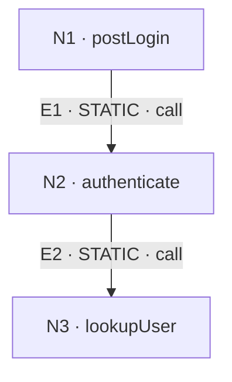

# Code Flow — Demo login request

> **Illustration only:** The linked code is a tiny synthetic fixture. Both edges are statically resolved; no runtime test or trace was executed. The diagram is **not** proof that any particular request ran these calls.

| Field | Value |
|---|---|
| Source | [demo-code.ts](./demo-code.ts) |
| Scope | `postLogin` → `authenticate` → `lookupUser` |
| Runtime evidence | Not collected |

## Call graph



## Evidence table

| ID | Edge | Status | Source fact |
|---|---|---|---|
| [E1](#e1) | `postLogin` → `authenticate` | STATIC | [demo-code.ts](./demo-code.ts), line 14: direct call |
| [E2](#e2) | `authenticate` → `lookupUser` | STATIC | [demo-code.ts](./demo-code.ts), line 10: direct call |

## Expand details

<a id="e1"></a>
<details>
<summary><strong>E1 · postLogin → authenticate</strong> — direct call</summary>

[demo-code.ts](./demo-code.ts), line 14:

```ts
const user = await authenticate(request.email);
```

This shows a direct call expression, not a runtime observation.

</details>

<a id="e2"></a>
<details>
<summary><strong>E2 · authenticate → lookupUser</strong> — direct call</summary>

[demo-code.ts](./demo-code.ts), line 10:

```ts
return lookupUser(email);
```

This does not establish whether `lookupUser` returned a user, which branch ran, or whether an actual request reached this path.

</details>

## Uncertainties

- No real HTTP router, external database, or runtime instrumentation is represented.
- Return status depends on the `user` value; the diagram only shows static call relationships.
