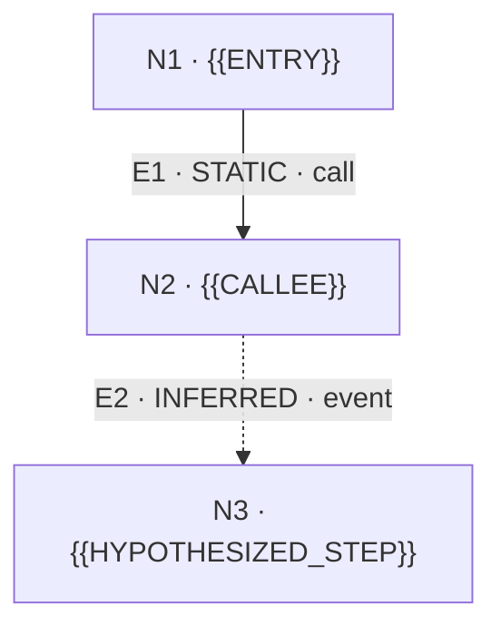

<!-- rumdl-disable MD040 -->

# Code Flow — {{TOPIC}}

> **Finding:** {{ONE_SENTENCE_CONCLUSION}}
>
> **Evidence boundary:** `OBSERVED` = seen in an identified scenario; `STATIC` = resolved in source; `INFERRED` = hypothesis; `UNRESOLVED` = insufficient evidence. Neither source existence nor a diagram proves actual runtime execution.

| Field | Value |
| --- | --- |
| Repository / revision | `{{REPOSITORY}}` / `{{COMMIT_OR_WORKTREE}}` |
| Question | {{QUESTION}} |
| Entry point | `{{ENTRY_SYMBOL_OR_PATH}}` |
| Coverage | {{FILES_OR_BOUNDARY_INSPECTED}} |
| Runtime trace | {{TRACE_ID_OR_NOT_RUN}} |
| Generated | {{DATE_OR_NOT_RECORDED}} |

## Flow overview



**Legend:** `-->` = source-resolved or scenario-observed connection (**read status label**); `-.->` = inferred or candidate-bounded unresolved connection. Arrows indicate the **reported relationship direction**, not automatically a guaranteed runtime order.

## Edge evidence

| ID | From → To | Relation | Status | Evidence and limits |
| --- | --- | --- | --- | --- |
| [E1](#e1) | N1 → N2 | call | STATIC | [{{FILE_A}}]({{RELATIVE_FILE_LINK_A}}), lines {{LINE_RANGE_A}}; {{WHAT_THIS_PROVES}} |
| [E2](#e2) | N2 → N3 | event | INFERRED | No direct edge evidence; {{WHAT_IS_MISSING}} |

## Detailed evidence

<a id="e1"></a>
<details>
<summary><strong>E1 · N1 → N2</strong> — STATIC, source-resolved call (expand)</summary>

- **Source:** [{{FILE_A}}]({{RELATIVE_FILE_LINK_A}}), lines {{LINE_RANGE_A}}
- **Observation:** {{EXACT_SOURCE_FACT}}
- **Limit:** This shows a code-level relationship, **not** an executed runtime call.

```{{LANGUAGE}}
{{SMALL_RELEVANT_SOURCE_SNIPPET}}
```

</details>

<a id="e2"></a>
<details>
<summary><strong>E2 · N2 → N3</strong> — INFERRED, not confirmed (expand)</summary>

- **Hypothesis:** {{WHY_IT_MIGHT_BE_CONNECTED}}
- **Missing evidence:** {{REQUIRED_SOURCE_OR_TRACE}}
- **To verify:** {{SMALLEST_SAFE_NEXT_CHECK}}

</details>

## Alternative branches and uncertainties

- **Alternative/branch:** {{BRANCH_AND_GUARD_OR_NONE_FOUND}}
- **Unresolved:** {{MOST_IMPORTANT_UNKNOWN}}
- **Excluded/contradicted:** {{PROPOSED_EDGE_AND_CONTRADICTION_OR_NONE}}
- **Not inspected:** {{OUT_OF_SCOPE_MODULES_OR_BRANCHES}}

## Verification record

| Check | Result |
| --- | --- |
| Source paths/line ranges reread | {{PASS_FAIL_NOT_RUN}} |
| Call targets resolved | {{PASS_FAIL_PARTIAL_AND_SCOPE}} |
| Runtime tests/traces | {{OBSERVED_DETAILS_OR_NOT_RUN}} |
| Markdown/Mermaid preview | {{VIEWED_OR_NOT_VIEWED}} |

<details>
<summary><strong>Reproduction notes and commands</strong> (optional)</summary>

{{SAFE_NON_SECRET_COMMANDS_OR_NONE}}

</details>
