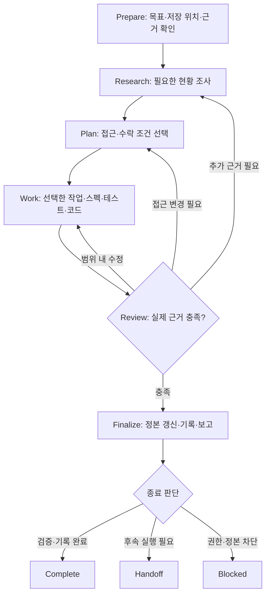

# Default Development Workflow

`mols-project-workflow`의 **개인 개발용 기본 실행 흐름**이다. [mols-loops](https://github.com/mols3131d/mols-agent-assets/tree/main/src/rulesync/.rulesync/skills/mols-loops)의 **Prepare → RPI → Finalize**를 작업 관리와 Spec/Test-driven 개발에 맞게 간소화했다. 독립적인 로컬 계약이므로 `mols-loops` 설치·실행, 루프 카운터, 별도 workflow JSON을 요구하지 않는다.

작업 선택·상태 조회만 하는 요청과 한 번의 작은 수정에는 전체 흐름을 **강제하지 않는다**. 필요하면 한 번의 확인·수정·검증으로 끝낸다. 복잡하거나 불확실한 변경에서만 RPI 재검토 루프가 실질적 가치를 낸다.

## Flow

`Complete / Handoff / Blocked`는 **이 실행의 결과**이며 작업 파일의 `todo / doing / done / cancelled`와 동일한 상태가 아니다. 이 워크플로에는 별도 `runs/`, 상태 파일이나 실행 로그를 만들지 않는다.

## Prepare — Scope and Readiness

1. 목표·수락 조건·이번에 실제 수행할 범위를 정한다. 기존 프로젝트 지침·사용자 선택·도구 권한이 우선한다.
2. 요청을 **Task-only / Spec-only / Combined / Small edit**로 판별한다. Task-only면 필요 없는 Spec 파일을 읽지 않고, Spec-only면 task를 새로 만들지 않는다.
3. 실제 repository/workspace, **Task root/ref, Spec root/ref, Code ref** 중 이번 작업에 필요한 것만 확인한다. 사용자 지정 경로와 branch를 기본값으로 덮어쓰지 않는다. 경로가 불명확하면 쓰기 전에 확인한다.
4. 관련 Work Item이 있다면 `doing`의 재개 가능성을 먼저 살피고, `todo`는 의존 작업이 실제로 완료된 경우만 ready로 본다. blocked/unknown을 우선순위로 우회하지 않는다.
5. 실행 가능한 도구, 읽기·쓰기 권한, 필요한 파일의 최신 상태를 확인한다. 실행 권한이나 검증 근거가 없으면 가능한 부분과 한계를 구별한다.

## Main — Adaptive RPI

| 단계 | 수행할 판단 | 산출물 |
| --- | --- | --- |
| **Research** | 선택된 작업과 관련 코드·요구사항·테스트·기존 정본을 필요한 만큼 읽는다. 모르는 사실을 추측하지 않는다. | 필요한 관찰·근거 |
| **Plan** | 완료 조건과 최소 변경 범위를 정한다. Spec이 유용한 변경이면 요구사항 delta를 어디에 기록할지 결정한다. | 상황에 따라 구두 계획 또는 짧은 문서 |
| **Work** | 변경의 위험과 성격에 맞게 task 파일, delta spec, 테스트, 코드를 수정한다. 테스트 선행은 유용할 때 선택한다. | 실제 수정된 파일 |
| **Review** | 요구사항·테스트·코드·검증 결과를 대조하고, 실패의 원인과 남은 작업을 식별한다. | 완료 후보 또는 구체적인 finding |

- Review에서 발견된 결함은 **가장 이른 영향 지점**으로 돌아간다. 요구사항 결함이면 Spec을 다시 확인하고 관련 테스트·코드를 재검토한다. 테스트 오류라면 무관한 Spec이나 계획을 반복하지 않는다.
- 새 근거가 필요하면 Research, 접근 자체가 바뀌면 Plan, 계획 내에서 수정 가능하면 Work로 돌아간다. **매 반복에 네 단계를 모두 재실행하지 않는다**.
- 작은 작업은 기존 근거와 방법이 충분하면 조사·계획을 별도 문서로 만들지 않는다. 스펙 중심 기능에는 `changes/<change-name>/specs/<domain-path>/spec.md` delta를, 계층 도메인 정본에는 `specs/<domain-path>/spec.md`를 사용한다. 사용자가 지정한 Spec root 안에서만 적용한다.
- 기존 도구·테스트·CI의 결과를 재사용한다. 테스트 코드가 제품 구현보다 먼저 작성된 예상된 red 상태와 실제 결함을 구분한다.
- 범위가 크게 바뀌면 당초 목표·승인·수락 조건을 다시 확인한다. 계속 같은 내용을 반복하거나 충분한 진전이 없으면 종료하고 남은 불확실성을 인계한다. **정해진 반복 횟수를 채우기 위한 루프는 없다**.

## Finalize — Independent Completion

1. Review 결과와 테스트·파일 변경의 **실제 근거**를 확인한다. 읽지 못한 파일, 실행하지 않은 스크립트·테스트를 PASS로 취급하지 않는다.
2. **Spec 반영이 필요한 경우만** 변경된 도메인 delta를 현재 정본과 대조한다. 미검증·stale baseline·충돌·쓰기 실패가 있으면 흡수하지 않는다. 영향받지 않은 요구사항은 보존한다. `changes/` 기록의 보관 여부는 프로젝트가 정한다.
3. **Task 기록이 있는 경우만** 실제 완료 확인 후 `done`으로 갱신한다. 중단·미완료라면 현재 확인한 것·남은 것·다음 행동을 해당 Markdown 파일에 짧게 남긴다.
4. Task / Spec / Code가 **서로 다른 ref**에 있다면 각 위치의 읽기·쓰기를 독립적으로 확인한다. 한쪽 성공을 다른 쪽 성공으로 해석하거나 교차 ref 원자성을 주장하지 않는다.
5. 완료한 내용, 변경된 경로/ref, 확인한 검증 결과, 미완료·차단된 사항을 구분하여 보고한다. 다음 세션에는 보존된 문구만 믿지 말고 파일과 실행 결과를 다시 확인한다.

## Modes and Boundaries

| 모드 | 적용 범위 | 생략하는 것 |
| --- | --- | --- |
| Task-only | 작업 분해·의존·우선순위·ready·재개·상태 갱신 | Spec delta, 구현 검증 단계 |
| Spec-only | 기대 동작·delta·테스트·구현·Review·정본 갱신 | 새 Task 파일, backlog 정렬 |
| Combined | ready/doing 작업 선택 후 필요한 Spec/Code 절차 | 강제 1:1 매핑, 자동 상태 동기화 |
| Small edit | 직접 변경하고 필요한 검증 후 보고 | Task/Spec 기록, 루프·계획 문서 |

이 파일은 **프레임워크의 로컬 개발 워크플로**이며 범용 `mols-loops`의 Run/Loop accounting, 재귀·상태 머신을 복제하지 않는다. 런타임에 `mols-loops`도 선택되어 있다면 해당 Skill이 바깥 Run을 조율하고, 이 문서는 **개인 프로젝트의 도메인 Work**와 완료 기준만 제공한다. 중첩된 두 번째 루프 오케스트레이터를 만들지 않는다.
