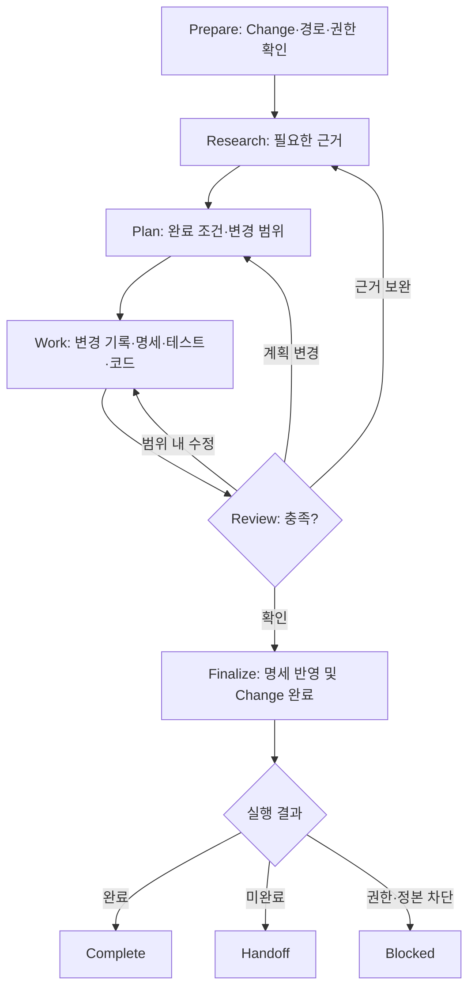

# Change Development Workflow

하나의 Change를 시작·수행·완료하는 흐름이다. `mols-loops`의 Prepare → RPI → Finalize를 개인 프로젝트에 맞춰 적용한다. 실행 엔진·루프 상태 파일을 추가하지 않으며 간단한 작업은 한 번의 확인·수정·검증으로 충분하다.

`Complete/Handoff/Blocked`는 실행 결과로, `work.md`의 저장 상태와 같지 않다.

## Prepare

목표·수락 조건과 해당 Change의 `work.md`를 찾는다. 첫 도입이면 [Bootstrap](bootstrap.md)을 읽는다. 기록할 가치가 있는 새 변경에만 Change를 만든다. work/spec/code의 root/ref와 각 정본을 확인하고, 이미 진행 중인 `doing` 기록을 우선 재검토한다. 선행 Change가 미완료·취소·누락·순환이면 ready로 간주하지 않는다. 실제 계정·권한·현재 파일을 확인한다.

## RPI

- **Research:** Change, 관련 도메인 정본, 코드·테스트·검증 근거를 필요만큼 읽고 과거 기록의 최신성을 확인한다.
- **Plan:** 완료 조건과 최소 변경 범위, 필요한 명세 delta와 테스트를 정한다. 행동 계약에 변화가 없으면 Spec 파일을 만들지 않는다.
- **Work:** `work.md`의 진행 사실·다음 행동을 유용할 때 갱신하고 필요한 delta·테스트·코드를 수정한다. Test-first가 유용하다면 적용한다.
- **Review:** 요구사항·검증·코드·최신 정본을 대조한다. 요구사항 결함이면 관련 명세부터, 검증 부족이면 해당 테스트부터 돌아간다. 무관한 단계를 재실행하지 않는다.

새 근거가 필요하면 Research, 접근이 바뀌면 Plan, 범위 내 수정을 해야 하면 Work로 돌아간다. 필수 Proposal/Research/Plan 문서나 반복 횟수는 없다. 범위·권한이 달라지면 확인을 갱신한다.

## Finalize: One Completion Gate

1. 실제 테스트·구현·Review와 파일 작업의 근거를 확인한다. 미실행 검증은 통과로 취급하지 않는다.
2. 명세 delta가 있으면 **현재** 도메인 정본·기준 버전·검증 결과를 대조해 검증된 부분만 반영한다. 일부 ref만 갱신된 상태로 재개한다면 **이미 반영된 요구사항은 현재 정본에서 확인해 중복 적용하지 않는다**. 변경의 반영 여부가 불명확하거나 stale·충돌·권한 부족·쓰기 실패라면 완료를 중단한다.
3. 해당 Change의 모든 완료 조건과 필수 반영이 충족되었을 때만, 최신 `work.md`를 재조회한 뒤 충돌 없이 **하나의 `work.md`를 `done`으로 기록**한다. 일부 ref만 성공했으면 기존 진행 상태를 유지하고 남은 검증·반영·다음 행동을 기록한다.
4. 변경한 각 ref의 결과를 다시 확인하고 완료·인계·차단을 정확히 보고한다. cross-ref 원자성·다른 곳의 성공을 추정하지 않는다.

단순 조회나 작은 수정을 위해 변경·명세 파일을 강제하지 않는다. 이는 별도의 실행 모드가 아니라 동일한 변경 절차를 필요한 만큼만 수행하는 것이다. `mols-loops`가 별도로 선택되면 그 Skill이 바깥 Run을 조율하며 이 문서는 도메인 Work만 소유한다.
